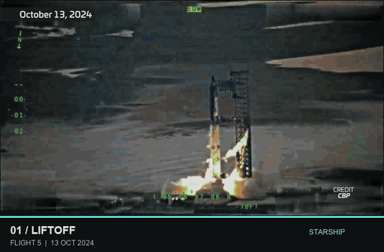

# 🚀 I love Starship

Watching the future take flight.

**Liftoff → first booster catch → S42 comes home**

Flight 5 · October 13, 2024 &nbsp; | &nbsp; S42 / Flight 15 · November 14, 2026

Footage & credits

- **Flight 5 launch and first Super Heavy catch:** U.S. Customs and Border Protection, [aerostat footage via Wikimedia Commons](https://commons.wikimedia.org/wiki/File:IFT5_Aerostat.webm). Listed as a U.S. federal government work in the public domain in the United States.
- **S42 return, landing burn and tower catch:** SpaceX, [official Flight 15 replay](https://x.com/SpaceX/status/2121715216597827756). Footage © SpaceX; all rights remain with the original owner.
- Edited into a silent looping montage: selected excerpts, 3× playback speed, resized, with milestone captions. Original footage and full replays are linked above.

